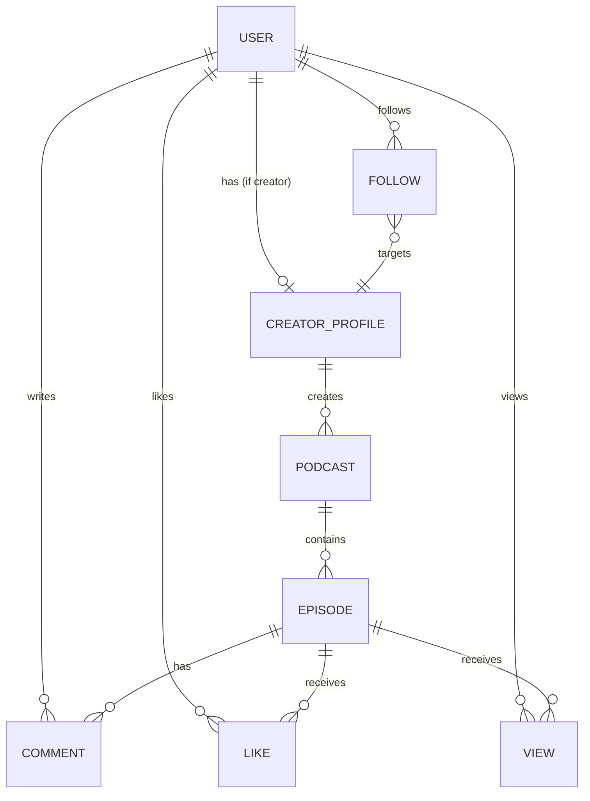

# Data Model: RAWY Podcast Platform – Backend (MVP)

**Branch**: `001-podcast-platform-backend`  
**Date**: 2026-03-03  
**Storage**: MongoDB 7.x via Mongoose ODM

## Entity Relationship Overview

## Entities

### User

**Collection**: `users`

| Field | Type | Constraints | Description |
|-------|------|-------------|-------------|
| `_id` | ObjectId | PK, auto | MongoDB default ID |
| `name` | String | Required, min: 2, max: 50 | User display name |
| `email` | String | Required, unique, indexed | Login identifier |
| `passwordHash` | String | Optional (null for OAuth-only users) | bcrypt hash, 10 salt rounds |
| `role` | String (enum) | Required, default: `USER` | `USER` \| `CREATOR` \| `ADMIN` |
| `isActive` | Boolean | Required, default: `true` | Deactivated users cannot access platform |
| `googleId` | String | Optional, sparse unique index | Google OAuth subject ID |
| `facebookId` | String | Optional, sparse unique index | Facebook OAuth subject ID |
| `deviceTokens` | [String] | Default: `[]` | FCM device tokens for push notifications |
| `refreshToken` | String | Optional | Hashed refresh token for session management |
| `refreshTokenExpiresAt` | Date | Optional | Refresh token expiry timestamp |
| `createdAt` | Date | Auto (timestamps) | Account creation date |
| `updatedAt` | Date | Auto (timestamps) | Last update date |

**Indexes**:
- `{ email: 1 }` — unique
- `{ googleId: 1 }` — sparse unique
- `{ facebookId: 1 }` — sparse unique
- `{ role: 1 }` — for admin queries

---

### CreatorProfile

**Collection**: `creator_profiles`

| Field | Type | Constraints | Description |
|-------|------|-------------|-------------|
| `_id` | ObjectId | PK, auto | MongoDB default ID |
| `userId` | ObjectId | Required, unique, ref: `User`, indexed | One-to-one with User |
| `bio` | String | Optional, max: 500 | Creator biography |
| `avatarUrl` | String | Optional | Avatar image file path |
| `socialLinks` | Object | Optional | `{ website?, twitter?, instagram?, youtube? }` |
| `followerCount` | Number | Default: 0, min: 0 | Denormalized follower count |
| `podcastCount` | Number | Default: 0, min: 0 | Denormalized podcast count |
| `createdAt` | Date | Auto (timestamps) | Profile creation date |
| `updatedAt` | Date | Auto (timestamps) | Last update date |

**Indexes**:
- `{ userId: 1 }` — unique

---

### Podcast

**Collection**: `podcasts`

| Field | Type | Constraints | Description |
|-------|------|-------------|-------------|
| `_id` | ObjectId | PK, auto | MongoDB default ID |
| `title` | String | Required, min: 3, max: 100 | Podcast title |
| `description` | String | Required, min: 10, max: 2000 | Podcast description |
| `coverImageUrl` | String | Optional | Cover image file path |
| `creatorId` | ObjectId | Required, ref: `User`, indexed | Owning creator |
| `episodeCount` | Number | Default: 0, min: 0 | Denormalized episode count |
| `createdAt` | Date | Auto (timestamps) | Creation date |
| `updatedAt` | Date | Auto (timestamps) | Last update date |

**Indexes**:
- `{ creatorId: 1 }` — for querying creator's podcasts
- `{ createdAt: -1 }` — for chronological listing

---

### Episode

**Collection**: `episodes`

| Field | Type | Constraints | Description |
|-------|------|-------------|-------------|
| `_id` | ObjectId | PK, auto | MongoDB default ID |
| `title` | String | Required, min: 3, max: 200 | Episode title |
| `description` | String | Required, min: 10, max: 5000 | Episode description |
| `audioFileUrl` | String | Required | Audio file path |
| `duration` | Number | Optional, min: 0 | Duration in seconds |
| `podcastId` | ObjectId | Required, ref: `Podcast`, indexed | Parent podcast |
| `creatorId` | ObjectId | Required, ref: `User`, indexed | Creator (denormalized for fast queries) |
| `viewsCount` | Number | Default: 0, min: 0 | Denormalized view count |
| `likesCount` | Number | Default: 0, min: 0 | Denormalized like count |
| `commentsCount` | Number | Default: 0, min: 0 | Denormalized comment count |
| `createdAt` | Date | Auto (timestamps) | Publication date (immediate) |
| `updatedAt` | Date | Auto (timestamps) | Last update date |

**Indexes**:
- `{ podcastId: 1, createdAt: -1 }` — episodes in a podcast, newest first
- `{ creatorId: 1 }` — for querying creator's episodes
- `{ createdAt: -1 }` — for global feed ordering

---

### Comment

**Collection**: `comments`

| Field | Type | Constraints | Description |
|-------|------|-------------|-------------|
| `_id` | ObjectId | PK, auto | MongoDB default ID |
| `text` | String | Required, min: 1, max: 1000 | Comment content |
| `userId` | ObjectId | Required, ref: `User`, indexed | Author |
| `episodeId` | ObjectId | Required, ref: `Episode`, indexed | Associated episode |
| `createdAt` | Date | Auto (timestamps) | Comment creation date |
| `updatedAt` | Date | Auto (timestamps) | Last update date |

**Indexes**:
- `{ episodeId: 1, createdAt: 1 }` — comments on an episode, oldest first

---

### Like

**Collection**: `likes`

| Field | Type | Constraints | Description |
|-------|------|-------------|-------------|
| `_id` | ObjectId | PK, auto | MongoDB default ID |
| `userId` | ObjectId | Required, ref: `User` | User who liked |
| `episodeId` | ObjectId | Required, ref: `Episode` | Liked episode |
| `createdAt` | Date | Auto (timestamps) | Like timestamp |

**Indexes**:
- `{ userId: 1, episodeId: 1 }` — **compound unique** (prevents duplicate likes)
- `{ episodeId: 1 }` — for counting likes on an episode

---

### Follow

**Collection**: `follows`

| Field | Type | Constraints | Description |
|-------|------|-------------|-------------|
| `_id` | ObjectId | PK, auto | MongoDB default ID |
| `followerId` | ObjectId | Required, ref: `User` | User who follows |
| `creatorId` | ObjectId | Required, ref: `User` | Creator being followed |
| `createdAt` | Date | Auto (timestamps) | Follow timestamp |

**Indexes**:
- `{ followerId: 1, creatorId: 1 }` — **compound unique** (prevents duplicate follows)
- `{ creatorId: 1 }` — for getting a creator's followers
- `{ followerId: 1 }` — for getting a user's followed creators

---

### View

**Collection**: `views`

| Field | Type | Constraints | Description |
|-------|------|-------------|-------------|
| `_id` | ObjectId | PK, auto | MongoDB default ID |
| `userId` | ObjectId | Required, ref: `User` | User who viewed |
| `episodeId` | ObjectId | Required, ref: `Episode` | Viewed episode |
| `createdAt` | Date | Auto (timestamps) | View timestamp |

**Indexes**:
- `{ userId: 1, episodeId: 1 }` — **compound unique** (prevents duplicate views)
- `{ episodeId: 1 }` — for counting views on an episode

## Denormalization Strategy

The following counts are denormalized for read performance:

| Counter | Stored On | Updated By |
|---------|-----------|------------|
| `followerCount` | CreatorProfile | Follow/Unfollow operations (`$inc: ±1`) |
| `podcastCount` | CreatorProfile | Podcast create/delete operations (`$inc: ±1`) |
| `episodeCount` | Podcast | Episode create/delete operations (`$inc: ±1`) |
| `likesCount` | Episode | Like/Unlike operations (`$inc: ±1`) |
| `viewsCount` | Episode | View creation (`$inc: 1`) |
| `commentsCount` | Episode | Comment create/delete operations (`$inc: ±1`) |

All counter updates use MongoDB's atomic `$inc` operator to prevent race conditions.

## Cascade Delete Rules

| When Deleted | Also Delete | Also Update |
|-------------|-------------|-------------|
| Podcast | All child Episodes, their Likes, Comments, Views | CreatorProfile.podcastCount (`$inc: -1`) |
| Episode | All Likes, Comments, Views for that episode | Podcast.episodeCount (`$inc: -1`) |
| Comment | — | Episode.commentsCount (`$inc: -1`) |
| Like | — | Episode.likesCount (`$inc: -1`) |
| User (deactivated) | — (soft deactivation, not hard delete) | — |
