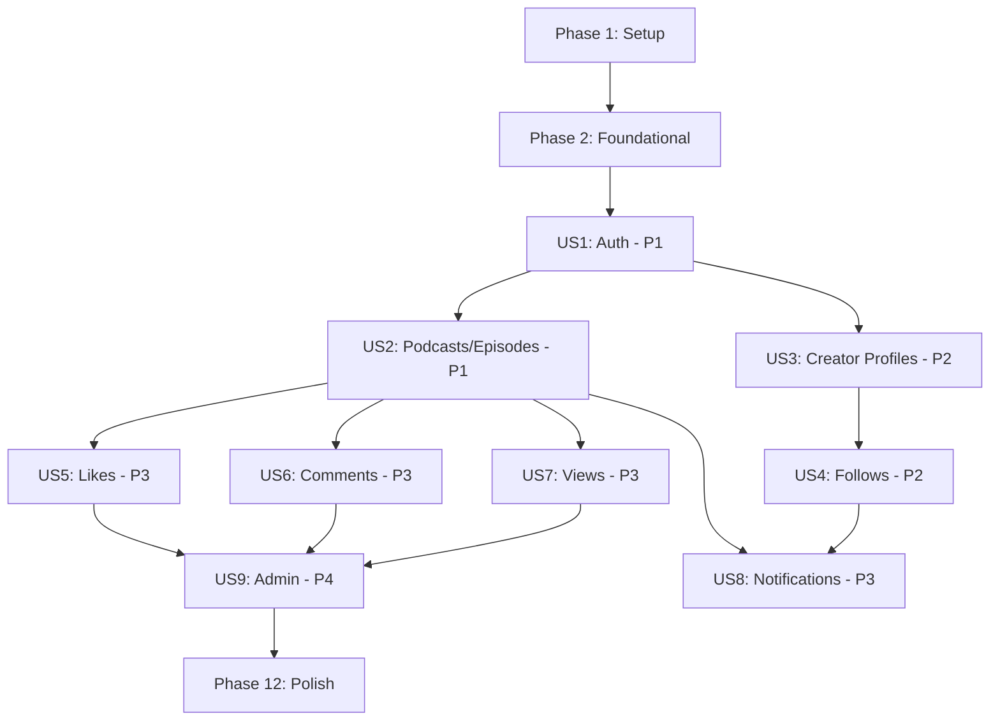

# Tasks: RAWY Podcast Platform – Backend (MVP)

**Input**: Design documents from `/specs/001-podcast-platform-backend/`
**Prerequisites**: plan.md, spec.md, research.md, data-model.md, contracts/api-endpoints.md, quickstart.md

**Tests**: Not explicitly requested — test tasks omitted. Tests can be added via a follow-up pass.

**Organization**: Tasks grouped by user story to enable independent implementation and testing.

## Format: `[ID] [P?] [Story] Description`

- **[P]**: Can run in parallel (different files, no dependencies)
- **[Story]**: Which user story this task belongs to (e.g., US1, US2, US3)
- Exact file paths included in descriptions

## Path Conventions

- **Single NestJS project**: `src/` at repository root
- **Test directory**: `test/` at repository root
- **Upload storage**: `uploads/` at repository root (gitignored)

---

## Phase 1: Setup (Shared Infrastructure)

**Purpose**: Project initialization, dependency installation, and basic project structure

- [X] T001 Initialize NestJS project with `npx -y @nestjs/cli new backend --package-manager npm --skip-git` in project root
- [X] T002 Install core dependencies: @nestjs/mongoose, mongoose, @nestjs/passport, passport, passport-jwt, passport-local, @nestjs/jwt, @nestjs/swagger, swagger-ui-express, class-validator, class-transformer, bcrypt, firebase-admin, @nestjs/config, joi
- [X] T003 Install dev dependencies: @types/passport-jwt, @types/passport-local, @types/passport-google-oauth20, @types/passport-facebook, @types/bcrypt, @types/multer
- [X] T004 Install OAuth dependencies: passport-google-oauth20, passport-facebook
- [X] T005 Create `.env` file with all required environment variables per `quickstart.md` template
- [X] T006 Create `.gitignore` with entries for node_modules, dist, .env, uploads/, firebase-service-account.json
- [X] T007 [P] Create upload directories: `uploads/audio/` and `uploads/images/`
- [X] T008 [P] Create placeholder `firebase-service-account.json` (gitignored) with instructions

---

## Phase 2: Foundational (Blocking Prerequisites)

**Purpose**: Core infrastructure that MUST be complete before ANY user story can be implemented

**⚠️ CRITICAL**: No user story work can begin until this phase is complete

- [X] T009 Create role enum and constants in `src/common/constants/roles.enum.ts` with USER, CREATOR, ADMIN values
- [X] T010 [P] Create pagination DTO in `src/common/dto/pagination-query.dto.ts` with page, limit fields (defaults: page=1, limit=20, max=100)
- [X] T011 [P] Create paginated response interface in `src/common/dto/paginated-response.dto.ts` with data, total, page, limit, totalPages shape
- [X] T012 Create `@Public()` decorator in `src/common/decorators/public.decorator.ts` using SetMetadata
- [X] T013 [P] Create `@Roles()` decorator in `src/common/decorators/roles.decorator.ts` using SetMetadata
- [X] T014 [P] Create `@CurrentUser()` parameter decorator in `src/common/decorators/current-user.decorator.ts` to extract user from request
- [X] T015 Create global HTTP exception filter in `src/common/filters/http-exception.filter.ts` with consistent error response shape: { statusCode, message, error, timestamp }
- [X] T016 [P] Create response transform interceptor in `src/common/interceptors/transform.interceptor.ts` wrapping responses in { statusCode, data }
- [X] T017 Create configuration module in `src/config/config.module.ts` with Joi validation for all env vars (MONGODB_URI, JWT secrets, OAuth, Firebase, upload limits)
- [X] T018 Create User schema in `src/users/schemas/user.schema.ts` with all fields from data-model.md: name, email, passwordHash, role, isActive, googleId, facebookId, deviceTokens, refreshToken, refreshTokenExpiresAt. Add unique index on email, sparse unique on googleId/facebookId, index on role
- [X] T019 Create UsersModule in `src/users/users.module.ts` registering User schema with MongooseModule.forFeature, export UsersService
- [X] T020 Create UsersService in `src/users/users.service.ts` with findById, findByEmail, findByGoogleId, findByFacebookId, create, update, updateRefreshToken methods
- [X] T021 Configure `src/app.module.ts` as root module with MongooseModule.forRootAsync (config-driven MONGODB_URI), ConfigModule.forRoot, import UsersModule
- [X] T022 Configure `src/main.ts` with global ValidationPipe, exception filter, transform interceptor, Swagger setup at `/api/docs`, global prefix `/api/v1`, static file serving for `/uploads`, and CORS

**Checkpoint**: Foundation ready — user story implementation can now begin

---

## Phase 3: User Story 1 — User Registration & Authentication (Priority: P1) 🎯 MVP

**Goal**: Users can register (email/password), log in, receive JWT tokens, refresh tokens, and authenticate via Google/Facebook OAuth. Public endpoints accessible without auth.

**Independent Test**: Register a user, log in, verify tokens, refresh expired tokens, test OAuth flows — all without any other features.

### Implementation for User Story 1

- [X] T023 [US1] Create RegisterDto in `src/auth/dto/register.dto.ts` with name (min:2, max:50), email (IsEmail), password (min:8) validation using class-validator
- [X] T024 [P] [US1] Create LoginDto in `src/auth/dto/login.dto.ts` with email (IsEmail), password (IsNotEmpty) validation
- [X] T025 [P] [US1] Create RefreshTokenDto in `src/auth/dto/refresh-token.dto.ts` with refreshToken (IsNotEmpty) validation
- [X] T026 [P] [US1] Create TokenResponseDto in `src/auth/dto/token-response.dto.ts` with accessToken, refreshToken, user fields
- [X] T027 [US1] Create JwtStrategy in `src/auth/strategies/jwt.strategy.ts` extending PassportStrategy — validate JWT payload, lookup user, check isActive status
- [X] T028 [P] [US1] Create LocalStrategy in `src/auth/strategies/local.strategy.ts` extending PassportStrategy — validate email/password with bcrypt compare
- [X] T029 [US1] Create JwtAuthGuard in `src/common/guards/jwt-auth.guard.ts` — check for @Public() decorator to skip auth on public endpoints
- [X] T030 [P] [US1] Create RolesGuard in `src/common/guards/roles.guard.ts` — check user role against @Roles() decorator requirements (CREATOR inherits USER, ADMIN inherits all)
- [X] T031 [P] [US1] Create ActiveUserGuard in `src/common/guards/active-user.guard.ts` — reject deactivated users on protected routes
- [X] T032 [US1] Create AuthService in `src/auth/auth.service.ts` with register (hash password, create user, generate tokens), login (validate credentials, generate tokens), refreshTokens (validate stored refresh token, issue new pair), logout (clear refresh token), generateTokens (create access + refresh JWT pair, store hashed refresh token with expiry), validateOAuthUser (find-or-create user by OAuth provider)
- [X] T033 [US1] Create GoogleStrategy in `src/auth/strategies/google.strategy.ts` extending PassportStrategy with passport-google-oauth20 — extract profile, delegate to AuthService.validateOAuthUser
- [X] T034 [P] [US1] Create FacebookStrategy in `src/auth/strategies/facebook.strategy.ts` extending PassportStrategy with passport-facebook — extract profile, delegate to AuthService.validateOAuthUser
- [X] T035 [P] [US1] Create GoogleAuthGuard in `src/auth/guards/google-auth.guard.ts`
- [X] T036 [P] [US1] Create FacebookAuthGuard in `src/auth/guards/facebook-auth.guard.ts`
- [X] T037 [US1] Create AuthController in `src/auth/auth.controller.ts` with POST /auth/register, POST /auth/login, POST /auth/refresh, POST /auth/logout, GET /auth/google, GET /auth/google/callback, GET /auth/facebook, GET /auth/facebook/callback — add Swagger decorators (@ApiTags, @ApiOperation, @ApiResponse, @ApiBearerAuth)
- [X] T038 [US1] Create AuthModule in `src/auth/auth.module.ts` importing UsersModule, JwtModule.registerAsync, PassportModule, register all strategies and guards
- [X] T039 [US1] Update `src/app.module.ts` to import AuthModule, apply JwtAuthGuard as global APP_GUARD, apply RolesGuard as global APP_GUARD, apply ActiveUserGuard as global APP_GUARD
- [X] T040 [US1] Create UsersController in `src/users/users.controller.ts` with GET /users/me, PATCH /users/me — add Swagger decorators

**Checkpoint**: Authentication fully functional — users can register, login, refresh tokens, and OAuth works

---

## Phase 4: User Story 2 — Podcast & Episode Management (Priority: P1) 🎯 MVP

**Goal**: Creators can create/edit/delete podcasts with cover images and upload/edit/delete episodes with audio files. File uploads stored locally. Episode creation triggers push notification to followers.

**Independent Test**: Creator creates a podcast with cover image, uploads episode with audio file, edits both, deletes episode, verifies cascade cleanup.

### Implementation for User Story 2

- [X] T041 [P] [US2] Create Podcast schema in `src/podcasts/schemas/podcast.schema.ts` with fields from data-model.md: title, description, coverImageUrl, creatorId (ref: User, indexed), episodeCount. Add indexes: { creatorId: 1 }, { createdAt: -1 }
- [X] T042 [P] [US2] Create Episode schema in `src/episodes/schemas/episode.schema.ts` with fields from data-model.md: title, description, audioFileUrl, duration, podcastId (ref: Podcast, indexed), creatorId (ref: User, indexed), viewsCount, likesCount, commentsCount. Add indexes: { podcastId: 1, createdAt: -1 }, { creatorId: 1 }, { createdAt: -1 }
- [X] T043 [P] [US2] Create file upload configuration utility in `src/common/utils/file-upload.util.ts` — Multer diskStorage config with UUID filenames, file filter for audio (mp3, m4a, wav, ogg, aac) and image (jpg, jpeg, png, webp) types, size limits from env vars
- [X] T044 [P] [US2] Create CreatePodcastDto in `src/podcasts/dto/create-podcast.dto.ts` with title (min:3, max:100), description (min:10, max:2000) validation
- [X] T045 [P] [US2] Create UpdatePodcastDto in `src/podcasts/dto/update-podcast.dto.ts` with PartialType(CreatePodcastDto)
- [X] T046 [P] [US2] Create CreateEpisodeDto in `src/episodes/dto/create-episode.dto.ts` with title (min:3, max:200), description (min:10, max:5000), podcastId (IsMongoId), duration (optional, IsNumber, min:0)
- [X] T047 [P] [US2] Create UpdateEpisodeDto in `src/episodes/dto/update-episode.dto.ts` with title (optional), description (optional)
- [X] T048 [US2] Create PodcastsService in `src/podcasts/podcasts.service.ts` with create (verify creator owns, upload cover image, increment CreatorProfile.podcastCount), findAll (paginated, optional creatorId filter), findById, update (owner check), delete (cascade delete episodes + related likes/comments/views, decrement podcastCount, cleanup files)
- [X] T049 [US2] Create EpisodesService in `src/episodes/episodes.service.ts` with create (verify creator owns podcast, store audio file, increment Podcast.episodeCount, trigger notification), findAll (paginated, optional podcastId/creatorId filter), findById, update (owner check), delete (cascade delete likes/comments/views, decrement episodeCount, cleanup audio file)
- [X] T050 [US2] Create PodcastsController in `src/podcasts/podcasts.controller.ts` with POST /podcasts (multipart: coverImage), GET /podcasts (public, paginated), GET /podcasts/:id (public), PATCH /podcasts/:id (multipart: coverImage, owner), DELETE /podcasts/:id (owner|admin) — add @Roles(CREATOR) where needed, Swagger decorators, @UseInterceptors(FileInterceptor)
- [X] T051 [US2] Create EpisodesController in `src/episodes/episodes.controller.ts` with POST /episodes (multipart: audioFile), GET /episodes (public, paginated), GET /episodes/:id (public), PATCH /episodes/:id (owner), DELETE /episodes/:id (owner|admin) — add @Roles(CREATOR) where needed, Swagger decorators, @UseInterceptors(FileInterceptor)
- [X] T052 [US2] Create PodcastsModule in `src/podcasts/podcasts.module.ts` registering Podcast schema, importing UsersModule, export PodcastsService
- [X] T053 [US2] Create EpisodesModule in `src/episodes/episodes.module.ts` registering Episode schema, importing PodcastsModule, UsersModule, NotificationsModule (forward ref), export EpisodesService
- [X] T054 [US2] Update `src/app.module.ts` to import PodcastsModule and EpisodesModule

**Checkpoint**: Podcasts and episodes fully operational with file uploads, CRUD, and cascade deletes

---

## Phase 5: User Story 3 — Creator Profile & Role Elevation (Priority: P2)

**Goal**: Users can become creators (self-service role elevation), creator profiles are created with bio/avatar/social links, public profiles browsable by anyone.

**Independent Test**: User requests creator elevation, verifies role change, updates profile, another user browses the public profile.

### Implementation for User Story 3

- [X] T055 [P] [US3] Create CreatorProfile schema in `src/creators/schemas/creator-profile.schema.ts` with fields from data-model.md: userId (ref: User, unique, indexed), bio, avatarUrl, socialLinks (nested: website, twitter, instagram, youtube), followerCount, podcastCount. Add unique index: { userId: 1 }
- [X] T056 [P] [US3] Create BecomeCreatorDto in `src/creators/dto/become-creator.dto.ts` (empty body — just triggers elevation)
- [X] T057 [P] [US3] Create UpdateCreatorProfileDto in `src/creators/dto/update-creator-profile.dto.ts` with bio (optional, max:500), socialLinks (optional, nested object validation)
- [X] T058 [US3] Create CreatorsService in `src/creators/creators.service.ts` with becomeCreator (check not already creator, update user role to CREATOR, create CreatorProfile), getProfile (by userId or profileId, include follower/podcast counts), updateProfile (owner check, handle avatar upload), listCreators (paginated)
- [X] T059 [US3] Create CreatorsController in `src/creators/creators.controller.ts` with POST /creators/become (@Roles(USER)), GET /creators (public, paginated), GET /creators/:id (public), PATCH /creators/me (multipart: avatar, @Roles(CREATOR)) — Swagger decorators
- [X] T060 [US3] Create CreatorsModule in `src/creators/creators.module.ts` registering CreatorProfile schema, importing UsersModule, export CreatorsService
- [X] T061 [US3] Update `src/app.module.ts` to import CreatorsModule

**Checkpoint**: Creator elevation and profiles fully functional

---

## Phase 6: User Story 4 — Follow System (Priority: P2)

**Goal**: Users can follow/unfollow creators. Follower counts update atomically. Users can check follow status and list their followed creators.

**Independent Test**: User follows a creator, verifies follower count increases, checks follow status, unfollows, verifies count decreases.

### Implementation for User Story 4

- [X] T062 [P] [US4] Create Follow schema in `src/follows/schemas/follow.schema.ts` with followerId (ref: User), creatorId (ref: User). Add compound unique index: { followerId: 1, creatorId: 1 }, indexes: { creatorId: 1 }, { followerId: 1 }
- [X] T063 [US4] Create FollowsService in `src/follows/follows.service.ts` with follow (prevent self-follow, prevent duplicate via unique index, atomically increment CreatorProfile.followerCount), unfollow (remove follow, decrement followerCount), getStatus (check if user follows creator), getFollowing (paginated list of creators a user follows), getFollowers (paginated list of users following a creator)
- [X] T064 [US4] Create FollowsController in `src/follows/follows.controller.ts` with POST /follows/creators/:creatorId, DELETE /follows/creators/:creatorId, GET /follows/creators/:creatorId/status, GET /follows/me/following, GET /follows/creators/:creatorId/followers (public) — Swagger decorators
- [X] T065 [US4] Create FollowsModule in `src/follows/follows.module.ts` registering Follow schema, importing UsersModule, CreatorsModule, export FollowsService
- [X] T066 [US4] Update `src/app.module.ts` to import FollowsModule

**Checkpoint**: Follow/unfollow system fully functional with atomic counter updates

---

## Phase 7: User Story 5 — Episode Likes (Priority: P3)

**Goal**: Users can like/unlike episodes. Like counts update atomically. Duplicate likes prevented by compound unique index.

**Independent Test**: User likes an episode, verifies count, attempts duplicate (rejected), unlikes, verifies count decreases.

### Implementation for User Story 5

- [X] T067 [P] [US5] Create Like schema in `src/likes/schemas/like.schema.ts` with userId (ref: User), episodeId (ref: Episode). Add compound unique index: { userId: 1, episodeId: 1 }, index: { episodeId: 1 }
- [X] T068 [US5] Create LikesService in `src/likes/likes.service.ts` with likeEpisode (create like, atomically increment Episode.likesCount, handle duplicate via MongoError 11000), unlikeEpisode (remove like, decrement likesCount), getLikeStatus (check if user liked episode and return count), deleteLikesForEpisode (for cascade cleanup)
- [X] T069 [US5] Create LikesController in `src/likes/likes.controller.ts` with POST /likes/episodes/:episodeId, DELETE /likes/episodes/:episodeId, GET /likes/episodes/:episodeId/status — Swagger decorators
- [X] T070 [US5] Create LikesModule in `src/likes/likes.module.ts` registering Like schema, importing EpisodesModule, export LikesService
- [X] T071 [US5] Update `src/app.module.ts` to import LikesModule

**Checkpoint**: Like/unlike system fully functional with atomic counters and duplicate prevention

---

## Phase 8: User Story 6 — Episode Comments (Priority: P3)

**Goal**: Users can post flat comments on episodes, view all comments (paginated, ordered by date), and delete their own comments.

**Independent Test**: User posts a comment, views comments list, verifies ordering, deletes own comment.

### Implementation for User Story 6

- [X] T072 [P] [US6] Create Comment schema in `src/comments/schemas/comment.schema.ts` with text, userId (ref: User), episodeId (ref: Episode). Add index: { episodeId: 1, createdAt: 1 }
- [X] T073 [P] [US6] Create CreateCommentDto in `src/comments/dto/create-comment.dto.ts` with text (min:1, max:1000) validation
- [X] T074 [US6] Create CommentsService in `src/comments/comments.service.ts` with createComment (save comment, atomically increment Episode.commentsCount), getCommentsByEpisode (paginated, ordered by createdAt ASC, populate user name/avatar), deleteComment (author-only or admin, decrement commentsCount), deleteCommentsForEpisode (for cascade cleanup)
- [X] T075 [US6] Create CommentsController in `src/comments/comments.controller.ts` with POST /comments/episodes/:episodeId, GET /comments/episodes/:episodeId (public, paginated), DELETE /comments/:commentId (author|admin) — Swagger decorators
- [X] T076 [US6] Create CommentsModule in `src/comments/comments.module.ts` registering Comment schema, importing EpisodesModule, UsersModule, export CommentsService
- [X] T077 [US6] Update `src/app.module.ts` to import CommentsModule

**Checkpoint**: Comment system fully functional with flat comments, pagination, and author deletion

---

## Phase 9: User Story 7 — Episode Views Tracking (Priority: P3)

**Goal**: Record unique views per user per episode. Prevent duplicate counting. Display total view count on episodes.

**Independent Test**: User views an episode, count increments, same user views again (count stays same — idempotent).

### Implementation for User Story 7

- [X] T078 [P] [US7] Create View schema in `src/views/schemas/view.schema.ts` with userId (ref: User), episodeId (ref: Episode). Add compound unique index: { userId: 1, episodeId: 1 }, index: { episodeId: 1 }
- [X] T079 [US7] Create ViewsService in `src/views/views.service.ts` with recordView (create view if not exists using findOneAndUpdate with upsert, atomically increment Episode.viewsCount only on new view, return current count), deleteViewsForEpisode (for cascade cleanup)
- [X] T080 [US7] Create ViewsController in `src/views/views.controller.ts` with POST /views/episodes/:episodeId — idempotent response (201 on new, 200 on existing) — Swagger decorators
- [X] T081 [US7] Create ViewsModule in `src/views/views.module.ts` registering View schema, importing EpisodesModule, export ViewsService
- [X] T082 [US7] Update `src/app.module.ts` to import ViewsModule

**Checkpoint**: View tracking fully functional with duplicate prevention and atomic counting

---

## Phase 10: User Story 8 — Push Notifications (Priority: P3)

**Goal**: When a creator publishes a new episode, all followers receive push notifications. Users can register/remove device tokens.

**Independent Test**: Register device token, creator publishes episode, verify notification dispatched via Firebase, handle invalid token gracefully.

### Implementation for User Story 8

- [X] T083 [US8] Create Firebase config in `src/notifications/firebase.config.ts` — initialize Firebase Admin SDK from service account JSON path in env var, export messaging instance
- [X] T084 [P] [US8] Create DeviceTokenDto in `src/users/dto/device-token.dto.ts` with token (IsString, IsNotEmpty) validation
- [X] T085 [US8] Create NotificationsService in `src/notifications/notifications.service.ts` with sendNewEpisodeNotification (accept creatorId, episodeTitle, podcastTitle — query all followers' deviceTokens, send via messaging().sendEachForMulticast, handle failed tokens by removing invalid ones from user records, log errors)
- [X] T086 [US8] Create NotificationsModule in `src/notifications/notifications.module.ts` importing firebase config, FollowsModule, UsersModule, export NotificationsService
- [X] T087 [US8] Add device token endpoints to UsersController in `src/users/users.controller.ts`: POST /users/me/device-token, DELETE /users/me/device-token
- [X] T088 [US8] Add addDeviceToken and removeDeviceToken methods to UsersService in `src/users/users.service.ts`
- [X] T089 [US8] Wire NotificationsService into EpisodesService in `src/episodes/episodes.service.ts` — call sendNewEpisodeNotification after episode creation
- [X] T090 [US8] Update `src/app.module.ts` to import NotificationsModule

**Checkpoint**: Push notifications sent to followers on new episodes, device token management works

---

## Phase 11: User Story 9 — Admin Platform Management (Priority: P4)

**Goal**: Admin can list users (paginated, filter by role/status), deactivate/activate users, promote users, remove content (podcasts, episodes, comments). First admin seeded from env vars.

**Independent Test**: Login as admin (seeded), list users, deactivate a user, verify they can no longer access protected routes, remove a podcast.

### Implementation for User Story 9

- [X] T091 [P] [US9] Create AdminQueryDto in `src/admin/dto/admin-query.dto.ts` extending PaginationQueryDto with optional role (IsEnum), isActive (IsBoolean) filters
- [X] T092 [P] [US9] Create PromoteUserDto in `src/admin/dto/promote-user.dto.ts` with role (IsEnum, only CREATOR|ADMIN allowed)
- [X] T093 [US9] Create SeedService in `src/seed/seed.service.ts` implementing OnModuleInit — check if any admin exists, if not create one using ADMIN_EMAIL and ADMIN_PASSWORD from env vars (hash password with bcrypt)
- [X] T094 [US9] Create SeedModule in `src/seed/seed.module.ts` importing UsersModule
- [X] T095 [US9] Create AdminService in `src/admin/admin.service.ts` with listUsers (paginated, filterable by role/isActive), deactivateUser (set isActive=false, clear refreshToken), activateUser (set isActive=true), promoteUser (update role, create CreatorProfile if promoting to CREATOR), removePodcast (delegate to PodcastsService.delete with cascade), removeEpisode (delegate to EpisodesService.delete with cascade), removeComment (delegate to CommentsService.delete), getStats (count users, creators, podcasts, episodes)
- [X] T096 [US9] Create AdminController in `src/admin/admin.controller.ts` with @Roles(ADMIN) on all endpoints: GET /admin/users, PATCH /admin/users/:userId/deactivate, PATCH /admin/users/:userId/activate, PATCH /admin/users/:userId/promote, DELETE /admin/podcasts/:podcastId, DELETE /admin/episodes/:episodeId, DELETE /admin/comments/:commentId, GET /admin/stats — Swagger decorators
- [X] T097 [US9] Create AdminModule in `src/admin/admin.module.ts` importing UsersModule, CreatorsModule, PodcastsModule, EpisodesModule, CommentsModule
- [X] T098 [US9] Update `src/app.module.ts` to import AdminModule and SeedModule

**Checkpoint**: Admin management fully functional, first admin seeded on startup

---

## Phase 12: Polish & Cross-Cutting Concerns

**Purpose**: Final improvements affecting multiple user stories

- [X] T099 [P] Add comprehensive Swagger ApiProperty decorators to all DTOs across all modules for complete API documentation
- [X] T100 [P] Add Swagger ApiResponse decorators for error responses (400, 401, 403, 404, 409) on all controllers
- [X] T101 Verify all cascade delete operations work correctly: delete a podcast and confirm episodes, likes, comments, views are removed and counters decremented
- [X] T102 [P] Add request logging interceptor in `src/common/interceptors/logging.interceptor.ts` — log method, URL, response time
- [X] T103 Review and verify all public endpoints are correctly decorated with @Public() — GET podcasts, episodes, creator profiles, comments
- [X] T104 [P] Create README.md in project root with project overview, setup instructions (reference quickstart.md), API documentation link, tech stack summary
- [X] T105 Verify environment variable validation catches missing required vars on startup (Joi schema in ConfigModule)
- [X] T106 Run full application smoke test: start server, verify Swagger loads at /api/docs, register user, create podcast, upload episode, like/comment/view, follow creator, admin operations

---

## Dependencies & Execution Order

### Phase Dependencies

- **Setup (Phase 1)**: No dependencies — can start immediately
- **Foundational (Phase 2)**: Depends on Phase 1 completion — BLOCKS all user stories
- **US1 Auth (Phase 3)**: Depends on Phase 2 — BLOCKS most other stories (provides auth infrastructure)
- **US2 Podcasts/Episodes (Phase 4)**: Depends on Phase 3 (needs auth, creator role validation)
- **US3 Creator Profiles (Phase 5)**: Depends on Phase 3 (needs auth) — can run in parallel with US2
- **US4 Follows (Phase 6)**: Depends on Phase 5 (needs CreatorProfile)
- **US5 Likes (Phase 7)**: Depends on Phase 4 (needs Episode schema) — can run in parallel with US3/US4
- **US6 Comments (Phase 8)**: Depends on Phase 4 (needs Episode schema) — can run in parallel with US5
- **US7 Views (Phase 9)**: Depends on Phase 4 (needs Episode schema) — can run in parallel with US5/US6
- **US8 Notifications (Phase 10)**: Depends on Phase 4 + Phase 6 (needs Episodes + Follows)
- **US9 Admin (Phase 11)**: Depends on all content modules (Phases 4-9)
- **Polish (Phase 12)**: Depends on all user stories being complete

### User Story Dependencies



### Within Each User Story

- Schemas/DTOs before Services (can be parallel with each other)
- Services before Controllers
- Module registration before app.module update
- All story tasks before checkpoint

### Parallel Opportunities

**Within Phase 2 (Foundational)**:
- T010, T011 (pagination DTOs) can run in parallel
- T012, T013, T014 (decorators) can run in parallel
- T015, T016 (filter, interceptor) can run in parallel

**Within US1 (Auth)**:
- T023, T024, T025, T026 (all DTOs) can run in parallel
- T028 (LocalStrategy), T030 (RolesGuard), T031 (ActiveUserGuard) can run in parallel
- T033 (GoogleStrategy), T034 (FacebookStrategy), T035, T036 (Guards) can run in parallel

**Within US2 (Podcasts/Episodes)**:
- T041 (Podcast schema), T042 (Episode schema), T043 (file upload util) can run in parallel
- T044, T045, T046, T047 (all DTOs) can run in parallel

**Across Stories after Phase 4**:
- US5 (Likes), US6 (Comments), US7 (Views) can ALL run in parallel

---

## Parallel Example: User Story 2

```text
# Launch all schemas and utils in parallel:
T041: Create Podcast schema in src/podcasts/schemas/podcast.schema.ts
T042: Create Episode schema in src/episodes/schemas/episode.schema.ts
T043: Create file upload utility in src/common/utils/file-upload.util.ts

# Launch all DTOs in parallel:
T044: Create CreatePodcastDto
T045: Create UpdatePodcastDto
T046: Create CreateEpisodeDto
T047: Create UpdateEpisodeDto

# Then sequentially:
T048: PodcastsService (depends on T041, T044, T045)
T049: EpisodesService (depends on T042, T046, T047)
T050: PodcastsController (depends on T048)
T051: EpisodesController (depends on T049)
```

---

## Implementation Strategy

### MVP First (User Stories 1 + 2)

1. Complete Phase 1: Setup
2. Complete Phase 2: Foundational (CRITICAL — blocks all stories)
3. Complete Phase 3: US1 — Authentication
4. Complete Phase 4: US2 — Podcasts & Episodes
5. **STOP and VALIDATE**: Auth + content management working end-to-end
6. Deploy/demo if ready — this is a functional podcast backend!

### Incremental Delivery

1. Setup + Foundational → Foundation ready
2. US1 (Auth) → Users can register and login
3. US2 (Podcasts/Episodes) → Creators can publish content → **MVP!**
4. US3 (Creator Profiles) → Public creator pages
5. US4 (Follows) → Social graph established
6. US5 + US6 + US7 (Likes/Comments/Views) → Full engagement features **(parallel!)**
7. US8 (Notifications) → Push notifications live
8. US9 (Admin) → Platform management
9. Polish → Production hardening

### Parallel Team Strategy

With 3 developers after Phase 2:

1. **Team completes**: Setup + Foundational + US1 together
2. Once US1 is done:
   - Developer A: US2 (Podcasts/Episodes) → US8 (Notifications)
   - Developer B: US3 (Creator Profiles) → US4 (Follows)
   - Developer C: US5 (Likes) → US6 (Comments) → US7 (Views)
3. All join for: US9 (Admin) → Polish

---

## Notes

- [P] tasks = different files, no dependencies on incomplete tasks
- [Story] label maps task to specific user story for traceability
- Each user story is independently testable at its checkpoint
- Commit after each task or logical group
- Stop at any checkpoint to validate story independently
- Total: 106 tasks across 12 phases
