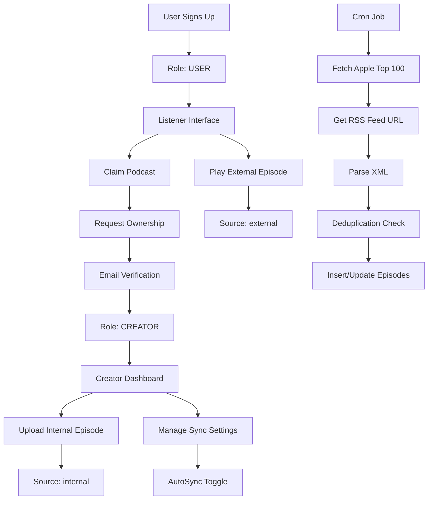

# RAWY Podcast Platform — Product Requirements Document (PRD) & Technical Specification

**Version**: 1.0  
**Date**: 2026-04-04  
**Platform**: Mobile (React Native) + Backend (NestJS + MongoDB)  
**Model**: Hybrid — Podcatcher (External RSS Feeds) + Hosting Platform (Internal Content)

---

## 1. Overview

Rawy is a podcast platform operating on a **Hybrid Model**:

- **Podcatcher**: Fetches and displays external podcasts via RSS feeds (Apple Podcasts integration)
- **Hosting Platform**: Allows creators to upload exclusive internal episodes
- **Claim System**: Users can claim ownership of externally synced podcasts and upgrade to creators

---

## 2. User Flow & Authentication (UI/UX & Roles)

### 2.1 Single Onboarding

| Step | Action |
|------|--------|
| 1 | User opens app for first time |
| 2 | Single sign-up screen (email/password or OAuth) |
| 3 | Account created with default role: `USER` |
| 4 | User lands on Listener Interface |

**Constraints**:

- No separate signup screens for creators
- All users start as `USER` role
- Single onboarding flow applies to both listeners and future creators

### 2.2 "Claim Your Podcast" Flow

| Step | Action |
|------|--------|
| 1 | User navigates to "Claim Podcast" screen |
| 2 | User searches for podcast (via Apple Podcasts API) |
| 3 | System displays matching podcasts with RSS feed URLs |
| 4 | User selects podcast to claim |
| 5 | System sends ownership verification email to podcast owner email |
| 6 | User clicks email verification link |
| 7 | Backend upgrades user role to `CREATOR` and links podcast to user |
| 8 | Refreshed JWT token issued with updated role |

**Verification Email Content**:

- Podcast title
- Claim requestor email
- "Verify Ownership" link with unique token
- 24-hour expiration

### 2.3 Dynamic Role Upgrade

```typescript
// Upon successful claim, execute role upgrade
async function upgradeToCreator(userId: string): Promise<JwtToken> {
  const user = await this.userModel.findById(userId);
  
  if (user.role === 'USER') {
    user.role = 'CREATOR';
    await user.save();
  }
  
  return this.generateJwtToken(user); // Fresh token with CREATOR role
}
```

### 2.4 UI Layouts

#### Standard Listener Interface

| Screen | Purpose |
|--------|---------|
| **Home** | Discoverable feed of trending/external podcasts |
| **Player** | Audio playback with controls, progress, chapter markers |
| **Library** | User's subscriptions, saved episodes, download queue |

#### Creator Dashboard

| Screen | Purpose |
|--------|---------|
| **Upload Exclusive Episode** | Form to upload audio, add title/description, select podcast |
| **Manage Sync Settings** | Toggle `autoSync` per external podcast, view sync status |
| **Analytics** | Listen counts, episode performance, follower growth |

---

## 3. Database Schema (MongoDB / Mongoose)

### 3.1 User Schema

**Collection**: `users`

| Field | Type | Constraints | Description |
|-------|------|-------------|-------------|
| `_id` | ObjectId | PK, auto | MongoDB default ID |
| `name` | String | Required, min: 2, max: 50 | User display name |
| `email` | String | Required, unique, indexed | Login identifier |
| `passwordHash` | String | Optional | bcrypt hash (null for OAuth) |
| `role` | String (enum) | Required, default: `USER` | `USER` \| `CREATOR` \| `ADMIN` |
| `isActive` | Boolean | Required, default: `true` | Soft delete flag |
| `googleId` | String | Optional, sparse unique | Google OAuth ID |
| `facebookId` | String | Optional, sparse unique | Facebook OAuth ID |
| `deviceTokens` | [String] | Default: `[]` | FCM push tokens |
| `refreshToken` | String | Optional | Hashed refresh token |
| `refreshTokenExpiresAt` | Date | Optional | Refresh token expiry |
| `createdAt` | Date | Auto (timestamps) | Account creation |
| `updatedAt` | Date | Auto (timestamps) | Last update |

**Indexes**:

```javascript
{ email: 1 }               // unique
{ googleId: 1 }            // sparse unique
{ facebookId: 1 }          // sparse unique
{ role: 1 }                // admin queries
```

### 3.2 Podcast Schema

**Collection**: `podcasts`

| Field | Type | Constraints | Description |
|-------|------|-------------|-------------|
| `_id` | ObjectId | PK, auto | MongoDB default ID |
| `title` | String | Required, min: 3, max: 100 | Podcast title |
| `description` | String | Required, min: 10, max: 2000 | Podcast description |
| `coverImageUrl` | String | Optional | Cover image path |
| `source` | String (enum) | Required, default: `external` | `external` \| `internal` |
| `ownerId` | ObjectId | Optional, ref: `User` | Owner (nullable for external) |
| `feedUrl` | String | Optional | RSS feed URL (external) |
| `itunesId` | String | Optional | Apple Podcasts ID |
| `autoSync` | Boolean | Default: `true` | Enable auto RSS sync |
| `lastSyncedAt` | Date | Optional | Last sync timestamp |
| `episodeCount` | Number | Default: 0 | Denormalized count |
| `createdAt` | Date | Auto (timestamps) | Creation date |
| `updatedAt` | Date | Auto (timestamps) | Last update |

**Indexes**:

```javascript
{ creatorId: 1 }           // for creator queries
{ source: 1 }               // for external/internal filtering
{ feedUrl: 1 }              // unique for external feeds
{ autoSync: 1 }            // for cron job optimization
```

### 3.3 Episode Schema

**Collection**: `episodes`

| Field | Type | Constraints | Description |
|-------|------|-------------|-------------|
| `_id` | ObjectId | PK, auto | MongoDB default ID |
| `title` | String | Required, min: 3, max: 200 | Episode title |
| `description` | String | Required, min: 10, max: 5000 | Episode description |
| `source` | String (enum) | Required | `external` \| `internal` |
| `audioStoragePath` | String | Optional | Internal upload path (`uploads/audio/`) |
| `audioUrl` | String | Optional | Public audio URL (external or internal) |
| `guid` | String | Optional | RSS GUID (external Apple tracking) |
| `duration` | Number | Optional, min: 0 | Duration in seconds |
| `podcastId` | ObjectId | Required, ref: `Podcast` | Parent podcast |
| `creatorId` | ObjectId | Required, ref: `User` | Creator (denormalized) |
| `pubDate` | Date | Optional | Publication date |
| `viewsCount` | Number | Default: 0 | View count |
| `likesCount` | Number | Default: 0 | Like count |
| `createdAt` | Date | Auto (timestamps) | Record creation |
| `updatedAt` | Date | Auto (timestamps) | Last update |

**Indexes**:

```javascript
{ podcastId: 1, createdAt: -1 } // episodes by podcast
{ guid: 1 }                     // external episode dedup
{ source: 1 }                  // filter by source
{ creatorId: 1 }               // creator queries
```

### 3.4 Claim Request Schema

**Collection**: `claim_requests`

| Field | Type | Constraints | Description |
|-------|------|-------------|-------------|
| `_id` | ObjectId | PK, auto | MongoDB default ID |
| `userId` | ObjectId | Required, ref: `User` | Requesting user |
| `podcastId` | ObjectId | Required, ref: `Podcast` | Target podcast |
| `verificationToken` | String | Required, unique | Email verification token |
| `status` | String (enum) | Default: `pending` | `pending` \| `approved` \| `rejected` |
| `expiresAt` | Date | Required | Token expiry (24h) |
| `createdAt` | Date | Auto (timestamps) | Request creation |
| `updatedAt` | Date | Auto (timestamps) | Last update |

---

## 4. Backend Automation & External Endpoints (Cron Jobs & Deduplication)

### 4.1 Automated Sync Engine

**Cron Schedule**: Every 6 hours (`0 */6 * * *`)

#### Fetch Flow

| Step | Action | Endpoint/Method |
|------|--------|-----------------|
| 1 | Fetch Top 100 Podcasts | `GET https://rss.applemarketingtools.com/api/v2/eg/podcasts/top/100/podcasts.json` |
| 2 | Extract `id` from results | Parse JSON response |
| 3 | Get RSS Feed URL | `GET https://itunes.apple.com/lookup?id={id}` |
| 4 | Parse XML from `feedUrl` | Use RSS parser (e.g., `rss-parser`) |
| 5 | Extract episode data | Parse `<item>` elements |
| 6 | Insert/Update episodes | Deduplication check → insert |

#### Data Fencing (Critical)

```typescript
// Cron job MUST filter by source
async function syncExternalPodcasts() {
  const externalPodcasts = await this.podcastModel.find({
    source: 'external',
    autoSync: true,
  });
  
  for (const podcast of externalPodcasts) {
    // Fetch RSS and update episodes
    // INTERNAL podcasts are STRICTLY IGNORED
  }
}
```

**Constraint**: Cron job **MUST ONLY** update podcasts where `source === 'external'`. Internally hosted content is never touched.

### 4.2 Deduplication Logic

Before inserting a new external episode:

```typescript
async function isDuplicateEpisode(podcastId: string, title: string, pubDate: Date): Promise<boolean> {
  // Check external episode by GUID
  const externalExists = await this.episodeModel.findOne({
    podcastId,
    guid: newEpisode.guid,
  });
  if (externalExists) return true;
  
  // Check internal episode with similar title in same week
  const oneWeekAgo = new Date(pubDate.getTime() - 7 * 24 * 60 * 60 * 1000);
  const internalSimilar = await this.episodeModel.findOne({
    podcastId,
    source: 'internal',
    title: { $regex: new RegExp(title, 'i') },
    pubDate: { $gte: oneWeekAgo },
  });
  if (internalSimilar) return true;
  
  return false;
}
```

**Rule**: If creator manually uploaded an internal episode with a similar title within ±1 week of the external episode's pubDate, skip insertion.

---

## 5. API Endpoints & Security Guards

### 5.1 Primary API Endpoints

#### Authentication (`/api/v1/auth`)

| Method | Endpoint | Auth | Description |
|--------|----------|------|-------------|
| POST | `/auth/register` | None | Create account (role: USER) |
| POST | `/auth/login` | None | Login |
| POST | `/auth/refresh` | None | Refresh JWT |
| POST | `/auth/logout` | JWT | Logout |

#### Podcasts (`/api/v1/podcasts`)

| Method | Endpoint | Auth | Description |
|--------|----------|------|-------------|
| GET | `/podcasts` | None | List podcasts (paginated) |
| GET | `/podcasts/:id` | None | Get podcast details |
| POST | `/podcasts` | JWT + `CREATOR` | Create internal podcast |
| PATCH | `/podcasts/:id` | JWT + `CREATOR` + owner | Update podcast |
| DELETE | `/podcasts/:id` | JWT + `CREATOR` + owner \| `ADMIN` | Delete podcast |

#### Episodes (`/api/v1/episodes`)

| Method | Endpoint | Auth | Description |
|--------|----------|------|-------------|
| GET | `/episodes` | None | List episodes (paginated) |
| GET | `/episodes/:id` | None | Get episode details |
| POST | `/episodes` | JWT + `CREATOR` | Upload internal episode |
| PATCH | `/episodes/:id` | JWT + `CREATOR` + owner | Update episode |
| DELETE | `/episodes/:id` | JWT + `CREATOR` + owner \| `ADMIN` | Delete episode |

#### Claim System (`/api/v1/claims`)

| Method | Endpoint | Auth | Description |
|--------|----------|------|-------------|
| POST | `/claims/request` | JWT | Request podcast ownership |
| GET | `/claims/verify/:token` | None | Verify email and upgrade role |
| GET | `/claims/status/:podcastId` | JWT | Check claim status |

#### Search (`/api/v1/search`)

| Method | Endpoint | Auth | Description |
|--------|----------|------|-------------|
| GET | `/search/podcasts` | None | Search Apple Podcasts |
| GET | `/search/external/:itunesId` | None | Get RSS feed for podcast |

### 5.2 NestJS Guards

```typescript
// Role Guard
@Roles('CREATOR')
@UseGuards(JwtAuthGuard, RolesGuard)
async uploadEpisode() { ... }

// Resource-Based Authorization Guard
@UseGuards(JwtAuthGuard, OwnershipGuard)
async updateEpisode(@Param('id') id: string) { ... }
```

#### Guard Implementation

```typescript
// roles.guard.ts
@Injectable()
export class RolesGuard extends AuthGuard('jwt') {
  canActivate(context: ExecutionContext) {
    return super.canActivate(context);
  }
  
  handleRequest(err, user) {
    if (!err && user) {
      return user;
    }
    throw err || new UnauthorizedException();
  }
}

// ownership.guard.ts
@Injectable()
export class OwnershipGuard implements CanActivate {
  async canActivate(context: ExecutionContext): Promise<boolean> {
    const request = context.switchToHttp().getRequest();
    const user = request.user;
    const resourceId = request.params.id;
    
    const resource = await this.getResource(resourceId);
    return resource.creatorId === user.id || user.role === 'ADMIN';
  }
}
```

### 5.3 Resource-Based Authorization Logic

```typescript
// Verify ownership before allowing episode uploads
async function verifyOwnership(userId: string, podcastId: string): Promise<boolean> {
  const podcast = await this.podcastModel.findById(podcastId);
  
  if (!podcast) {
    throw new NotFoundException('Podcast not found');
  }
  
  // Allow if user owns podcast OR is admin
  if (podcast.ownerId === userId || userId.role === 'ADMIN') {
    return true;
  }
  
  throw new ForbiddenException('You do not own this podcast');
}
```

---

## 6. Technical Constraints

| Constraint | Description |
|------------|-------------|
| **File Size Limit** | 100MB max per audio upload |
| **Storage Location** | Local filesystem: `./uploads/audio`, `./uploads/images` |
| **Cron Frequency** | Every 6 hours for external sync |
| **Token Expiry** | Access: 15min, Refresh: 7 days |
| **Verification Token** | 24-hour expiration |
| **Deduplication Window** | ±7 days from pubDate |

---

## 7. Data Flow Diagram



---

## 8. Security Considerations

- All internal episode uploads require `CREATOR` role + ownership verification
- External podcast syncing runs server-side only (no client exposure)
- Claim verification tokens are single-use and expire in 24 hours
- JWT tokens refreshed on role upgrade to immediately reflect new permissions
- Fencing: Cron jobs ignore `source === 'internal'` to prevent data corruption

---

## 9. Future Considerations

- OAuth providers: Google, Facebook (already in schema)
- Push notifications for new episodes
- Follow creator functionality
- Likes and comments on episodes
- Analytics dashboard expansion
- Episode chapters and show notes
